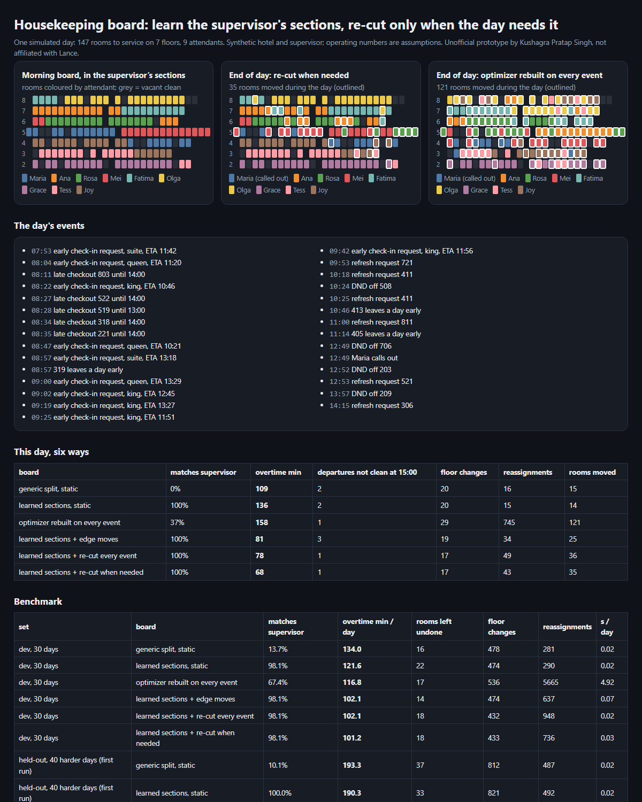

# Housekeeping board: learn the supervisor's sections, re-cut only when the day needs it

> Unofficial prototype by Kushagra Pratap Singh. Not affiliated with Lance. Synthetic hotels, staff and supervisor; every operating number is an assumption listed below.

## The problem

Lance Boards builds the day's housekeeping board "in your supervisor's style" and "redistributes the right rooms to the right people as the day moves" ([launch post](https://www.lance.live/news/lance-boards)). The post itself says where the difficulty is:

> Evening out checkouts and stayovers across attendants is the easy half of the job. A good supervisor is also thinking about which floors each attendant is going to, what their preferred sections are, and which wings of the hotel they're covering — so that nobody is walking more than they should. That judgment is exactly what a hotel loses on the supervisor's day off.

At AC Hotel SFO the board went from 2 hours to 2 minutes, and the supervisor and inspector roles were not backfilled ([case study](https://www.lance.live/hotels/ac-hotel-sf)). So the system has to carry that judgment **all day**, not just at 8 a.m.

The day keeps changing: late checkouts, guests leaving a day early, DND signs coming off, front-desk refresh requests, early check-ins, an attendant calling out at 12:49. Every change raises the same question: rebuild the board, or leave it? Rebuilding keeps the load even but reshuffles people's rooms. Leaving it means overtime and rooms left dirty.

## What I built

`hkboard`:

1. **Learns the supervisor's sections from 20 past boards.** For each attendant it records where in the hotel they usually work (credit-weighted floor and wing position). It never sees the supervisor's rules.
2. **Morning board.** It walks the hotel floor by floor and wing by wing, and cuts credit-balanced sections (departure 1.0, stayover 0.5, suite ×1.5). Sections go out in the learned order, so each person lands where the supervisor would put them.
3. **During the day ("re-cut when needed").**
   - After a call-out, or when any attendant is projected to run past the shift, it re-cuts the same sections over the rooms still to do. Each section is sized by that person's time left.
   - The order of people never changes, so only rooms near section edges move.
   - The projection uses only what the hotel knows at that minute: a "due out" room is assumed to free up at 10:30 until it actually checks out or a late checkout is approved. Rooms behind a DND sign are excluded until the sign comes off.
4. **A minute-level day simulator** that every policy runs through with the same attendant behaviour:
   - Each attendant does rooms blocked for an early check-in first, then refreshes, departures and stayovers, picking the nearest room.
   - Walking costs time per room, wing and floor, there's a lunch break, clean times are noisy, and anything not done by 18:00 counts as left undone.



## Results

Six ways to run the board, all with the same attendants, events and executor:

| board | during the day |
|---|---|
| generic split (room-number sections, roster order) | static, with a manual hand-out on call-out |
| learned sections | static |
| floor-wing affinity + local search | **rebuilt from scratch on every event** (a generic optimizer) |
| learned sections | ablation: move single rooms across section edges |
| learned sections | re-cut on every event |
| **learned sections** | **re-cut when needed** |

**Held-out set, first run:** 40 days, seeds plus a harder config (6–8 floors, 50% call-out days, 20% early check-ins), **committed to git before the first run**.

| board / day | matches supervisor | overtime min/day | rooms left undone | floor changes | reassignments |
|---|---|---|---|---|---|
| generic split, static | 10% | 193.3 | 37 | 812 | 487 |
| learned sections, static | 100% | 190.3 | 33 | 821 | 492 |
| optimizer rebuilt every event | 68% | 173.6 | 17 | 893 | **14,049** |
| learned sections + edge moves | 100% | 168.8 | 12 | 850 | 1,061 |
| learned sections + re-cut every event | 100% | 163.8 | 15 | 693 | 2,288 |
| **learned sections + re-cut when needed** | **100%** | **163.9** | 16 | **683** | 1,721 |

- **vs the generic static board:** re-cut when needed has 15% less overtime (lower or equal on 33/40 days), half the rooms left undone, and the fewest floor changes.
- **vs the optimizer rebuilt on every event:** less overtime with **8× fewer reassignments** (1,721 vs 14,049) and fewer floor changes.
- **vs edge moves:** edge moves come close (169 vs 164 min/day) with fewer reassignments but more floor changes. It's a real trade-off, and both are in the code.

Dev (30 days, used while building): 134.0 → 101.2 min/day overtime; 5,665 vs 736 reassignments.

**Honest notes:**
- **The 100% match is partly built in.** My synthetic supervisor cuts floor-order sections in home-floor order, and the planner learns that order. A real supervisor has quirks (suites, pairing, seniority) that this won't capture. The generic split's 10% shows what is lost without learning, not how good the learning would be on real boards.
- **Early check-ins don't separate the policies here.** Most early arrivals got a room left vacant overnight, and blocked rooms go first in every policy. 1 of 559 held-out early check-ins waited 15+ minutes under every policy. No claim there.
- **Development history.** While building, my first hidden supervisor gave one attendant floors 2 and 6 (unrealistic), and my roster was accidentally sorted by home floor, which made the "generic" split secretly match the supervisor (93%). Both were generator fixes made on dev days before the held-out set existed.
- **Dev-only tuning.** The edge-move repair was my first design. On dev, re-cutting the learned sections beat it on overtime, and re-cutting only when needed cut churn. All of that was decided on dev.
- **OPS assumptions:**
  - Departure 30 min, stayover 17 min, suite ×1.5, refresh 12 min.
  - Walking 0.4 min per room, 3 min per wing change, 6 min per floor change.
  - Shift 08:00–16:30 with a 30-min lunch, and staffing at 92% of paid minutes.
  - Checkout 11:00, check-in 15:00.
  - None of these are Lance's or any hotel's numbers.

## Run it

```
python demo.py                # one day, six ways -> out/report.html
python evaluate.py heldout    # or: dev
python -m pytest -q           # 7 tests
```

Python 3.10+, standard library only (pytest for tests). It takes about 0.05 s per simulated day for the re-cut policy, against about 9 s for the from-scratch optimizer.
